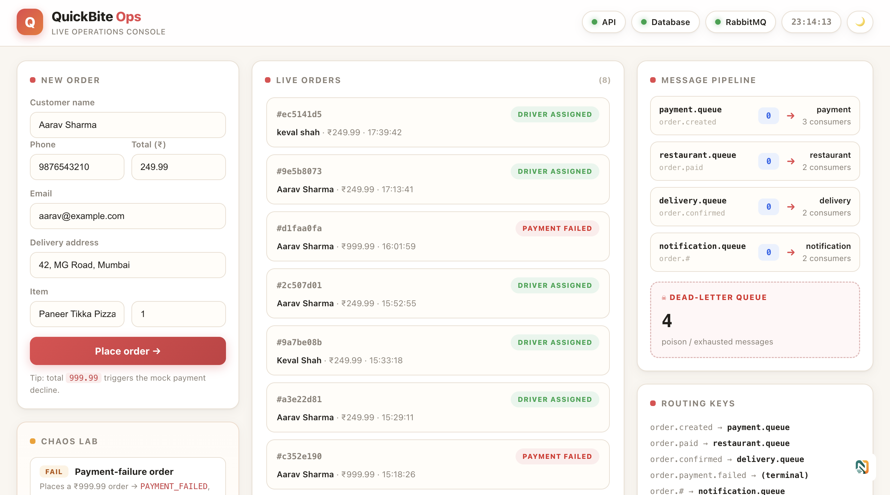
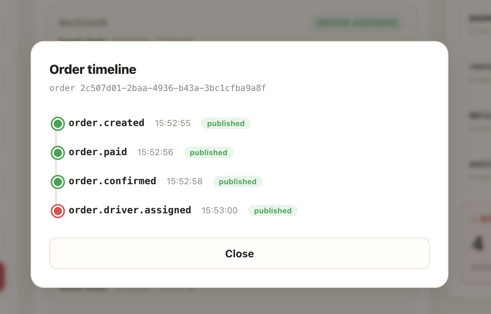
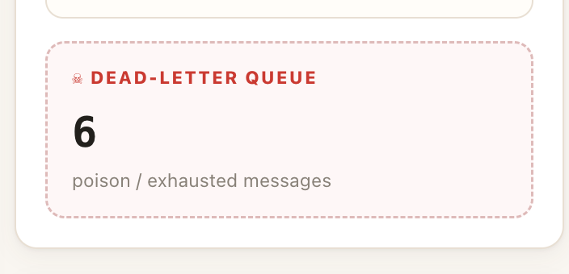
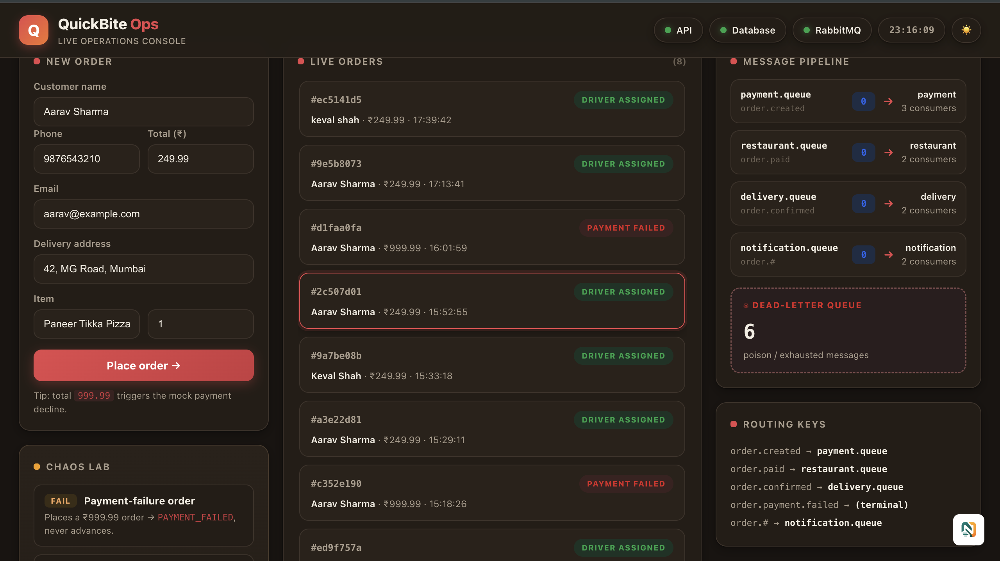
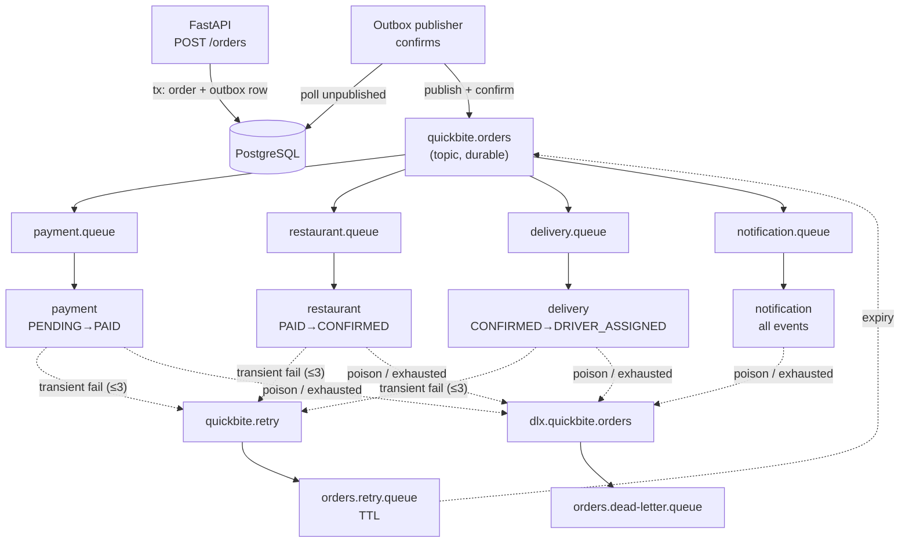

# QuickBite


**A reliable food-delivery order pipeline: FastAPI + RabbitMQ + PostgreSQL, with idempotent workers, bounded retries, a dead-letter queue, and a live operations console.**

Orders flow `PENDING → PAID → CONFIRMED → DRIVER_ASSIGNED` as events over a durable RabbitMQ topic exchange. No message is ever silently lost: publisher confirms, an outbox relay, atomic idempotency claims, and a DLQ for poison messages.

**[🚀 Live Demo](https://itinerary-rehire-ramrod.ngrok-free.dev/dashboard)**

*The demo is shared from a local instance via ngrok — it is reachable while that instance is running.*

## Screenshots

| Dashboard | Order timeline |
|---|---|
|  |  |

| Chaos Lab | Dark mode |
|---|---|
|  |  |

## Features

- **Event-driven order flow** — `order.created → order.paid → order.confirmed → order.driver.assigned` over the durable `quickbite.orders` topic exchange.
- **Outbox pattern** — orders and events commit in one transaction; a separate publisher relays with broker confirms.
- **At-least-once, exactly-once effect** — atomic `INSERT … ON CONFLICT DO NOTHING` idempotency claims absorb redeliveries, retries, and duplicates.
- **Bounded retries** — transient failures retry 3× with 5s/10s/20s TTL backoff (no plugins); exhaustion marks the order `FAILED`.
- **Dead-letter queue** — poison messages go straight to `orders.dead-letter.queue`, never wedging the pipeline.
- **Independent workers** — payment, restaurant, delivery, notification scale separately (`--scale worker-payment=3`).
- **Live operations console** — order form, live orders, event timelines, queue depths, DLQ counter, and a Chaos Lab (payment-fail / poison / duplicate), plus light/dark themes.
- **64 automated tests** — unit, integration, and live RabbitMQ/PostgreSQL tests.

## Architecture



See [`docs/ARCHITECTURE.md`](docs/ARCHITECTURE.md) for the full diagram and design decisions, and [`knowledge-bytes/`](knowledge-bytes/) for subsystem deep-dives.

## Quickstart

```bash
docker compose up -d
# wait ~20s for health checks
curl http://127.0.0.1:8002/health
```

Open the console: **http://127.0.0.1:8002/dashboard** — place an order and watch it flow.

Run the 5-minute demo: [`docs/DEMO.md`](docs/DEMO.md).

Run the tests:

```bash
python -m pytest -q                                   # 60 unit/mocked tests
QUICKBITE_RUN_LIVE=1 python -m pytest -q -m live      # 4 live broker/DB tests
```

Existing databases need one migration for the `FAILED` status:

```bash
psql "$DATABASE_URL" -f docs/migrations/001_add_failed_to_orderstatus.sql
```

## Project structure

```
quickbite/
├── app/                    # FastAPI app, workers, outbox publisher, ops API
│   ├── workers/            # payment, restaurant, delivery, notification
│   └── static/dashboard.html  # live operations console (no build step)
├── tests/                  # unit, integration, and live tests
├── docs/
│   ├── ARCHITECTURE.md     # full architecture + diagrams
│   ├── API.md              # REST + ops endpoint reference
│   ├── DEMO.md             # 5-minute demo script
│   ├── TESTING.md          # what was verified where
│   ├── TECHNICAL_REPORT.md # assignment technical report
│   ├── REQUIREMENTS_CHECKLIST.md
│   ├── migrations/         # SQL migrations
│   └── screenshots/        # dashboard screenshots
├── knowledge-bytes/        # subsystem deep-dives, traced to code
├── demo.sh                 # end-to-end CLI demo checklist
├── docker-compose.yml      # api, publisher, 4 workers, postgres, rabbitmq
└── Dockerfile
```

## Docs

- [Architecture](docs/ARCHITECTURE.md) · [API reference](docs/API.md) · [Demo guide](docs/DEMO.md)
- [Testing](docs/TESTING.md) · [Technical report](docs/TECHNICAL_REPORT.md) · [Requirements checklist](docs/REQUIREMENTS_CHECKLIST.md)
- [Knowledge bytes](knowledge-bytes/) — 8 subsystem notes, each traced to source files
